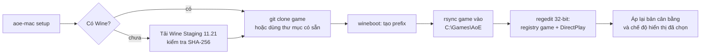

# Kiến trúc mac-aoe

## Vì sao dùng Wine thay vì viết lại game

Bản mod `age_of_empires_ror_hd` là game Windows 32-bit năm 1998 (DirectDraw
8-bit, DirectSound, DirectPlay). Có hai cách đưa nó lên macOS:

| Cách | Ưu điểm | Nhược điểm |
|------|---------|------------|
| Viết lại engine | Chạy native | Hàng năm công sức. Mất bug reset ruộng và AI của bản mod. Không thể giữ đúng hành vi gốc |
| Chạy qua Wine | Giữ 100% hành vi gốc, kể cả file `.ai`, `.per` và 3 bản `empires.dat` | Phụ thuộc chất lượng Wine trên macOS |

`mac-aoe` chọn Wine. Mục tiêu của cộng đồng Đế Chế là giữ nguyên lối chơi gốc,
nên đây là cách duy nhất đáp ứng được.

## Thành phần

```
aoe-mac                  CLI chính (bash 3.2)
lib/common.sh            Đường dẫn, file cấu hình, hàm tiện ích portable
lib/wine.sh              Tìm, tải và chạy Wine
lib/game.sh              Lấy game, tạo prefix, registry, cân bằng, hiển thị, chơi
lib/app.sh               Tạo AoE RoR.app
templates/               Registry, Info.plist, launcher của app
tests/                   Bộ test và Wine giả lập
```

## Luồng cài đặt



## Các quyết định kỹ thuật

**Bản Wine.** Homebrew đã tắt cask `wine-stable` từ 2026-09-01 vì bản build
không qua được Gatekeeper. Bộ công cụ tải thẳng bản build của
[Gcenx/macOS_Wine_builds](https://github.com/Gcenx/macOS_Wine_builds) qua `curl`,
ghim phiên bản và mã SHA-256. Bản này là WoW64, chạy được app Windows 32-bit trên
macOS vốn chỉ còn hỗ trợ 64-bit. Trên Apple Silicon nó chạy qua Rosetta 2. Bộ
công cụ không gỡ quarantine và không tắt Gatekeeper. Muốn thử bản Wine khác, đặt
`AOE_WINE_URL` kèm `AOE_WINE_SHA256`, hoặc trỏ `AOE_WINE` tới một `wine` có sẵn
(ví dụ của CrossOver).

**Registry.** Game đọc khoá
`HKLM\SOFTWARE\Microsoft\Games\Age of Empires\1.00`. Bản Expansion và chế độ chơi
mạng đọc thêm khoá `Age of Empires Expansion` và khoá DirectPlay. Các khoá và giá
trị trong `templates/aoe-registry.reg.in` lấy từ phân tích tĩnh file
`data/setupreg.exe` của game. Bộ công cụ không chạy file đó. Registry được import
bằng `C:\windows\syswow64\regedit.exe` để rơi vào view 32-bit mà game đọc. Lệnh
`aoe-mac doctor` kiểm tra lại bằng `reg query /reg:32`.

**Chế độ cửa sổ.** `empires.exe` tự nạp `data\wndmode.dll`. File
`data/wndmode.ini` điều khiển nó (`UseWindowMode=1` là chơi trong cửa sổ). Lệnh
`aoe-mac display` chỉ sửa khoá này và giữ nguyên kiểu xuống dòng CRLF của file.

**Tuỳ chỉnh Mac.** `templates/mac-driver.reg.in` bật `LeftCommandIsCtrl` để
`Command+số` dùng như `Ctrl+số`, và tắt `RetinaMode` để game 8-bit hiển thị đúng
kích thước.

**Cập nhật an toàn.** `rsync` chạy không có `--delete`, nên bản lưu và kịch bản do
người chơi tạo được giữ lại. Sau khi đồng bộ, bộ công cụ ghi lại bản cân bằng và
chế độ hiển thị từ file `config`, vì file trong repo sẽ ghi đè `empires.dat` và
`wndmode.ini`.

**Ứng dụng .app.** `build-app` nhúng toàn bộ bộ công cụ vào
`Contents/Resources/toolkit`. App vẫn chạy khi bạn xoá thư mục repo. Launcher
dùng `osascript` để hiện menu. Việc cài đặt, vốn tải nhiều dữ liệu, chạy trong
Terminal qua `setup.command` để người dùng thấy tiến trình. App được ký ad-hoc
(`codesign -s -`) và không cần Apple ID.

**Tương thích shell.** macOS dùng bash 3.2, nên code tránh mảng kết hợp,
`${var,,}`, `mapfile`, `sed -i` và `date --iso`. CI chạy test bằng `/bin/bash`
trên macOS.

---

HVN GROUP · hvn.vn
