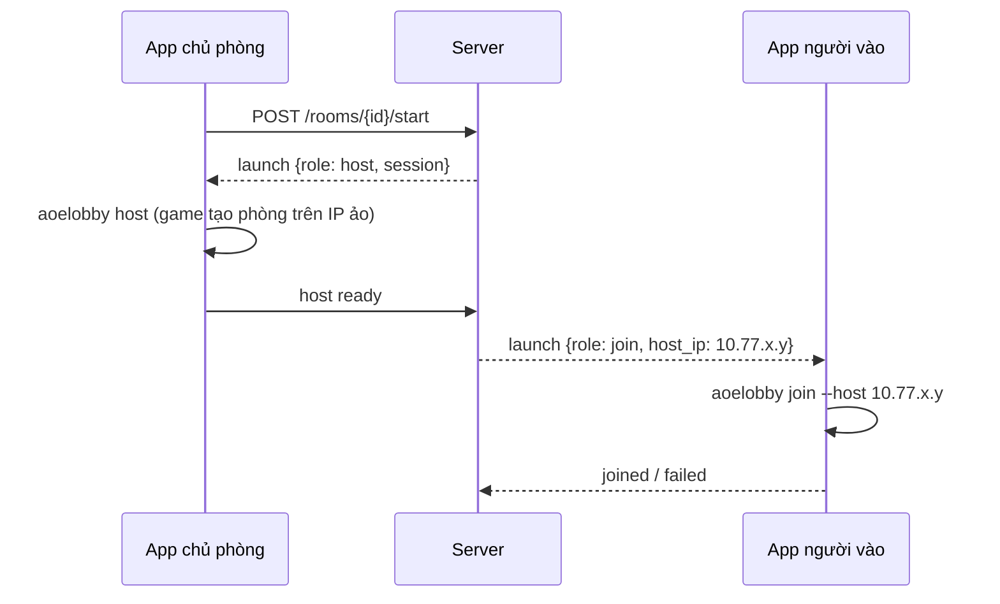

# Phase 5: Mở game một chạm

## Mục tiêu

Chủ phòng bấm **Bắt đầu**, mọi người trong phòng thấy game tự mở và vào cùng
một phòng trong game, không phải gõ IP.

## Luồng

## Việc cần làm

1. **Hoàn thiện `aoelobby.exe`** từ bản spike: tham số `--app-guid` (mặc định
   GUID của AoE RoR), `--name`, `--host`, `--session`, `--max`. Trả mã thoát rõ
   ràng và in JSON trạng thái ra stdout cho app đọc.
2. **Mac:** app gọi bộ công cụ `mac-aoe`: kiểm tra đã cài game, bật
   `directplay microsoft` và `display cnc-window`, rồi chạy
   `wine aoelobby.exe ...` trong prefix của mac-aoe. Thêm lệnh
   `aoe-mac lobby host|join ...` vào mac-aoe để app chỉ cần gọi một lệnh.
3. **Windows:** app tìm thư mục game (registry `EXE Path`, hoặc người chơi chọn).
   Nếu chưa có game, hướng dẫn cài theo phương án mà pháp chế chốt (rủi ro R5).
   Kiểm tra registry DirectPlay Applications; nếu thiếu thì chạy `setupreg.exe`
   của game với quyền người dùng.
4. **Chủ phòng sẵn sàng rồi người khác mới vào:** server chỉ gửi lệnh `join`
   sau khi app chủ phòng báo game đã mở phòng (thử kết nối TCP 2300 tới chính
   IP ảo của chủ phòng).
5. **Thất bại thì có đường lui:** quá 30 giây chưa vào được thì app hiện IP chủ
   phòng và hướng dẫn vào tay.

## Tiêu chí đạt

- [ ] Test tự động: `aoelobby.exe` chạy với `--app-guid` của một chương trình test DirectPlay tự viết (dùng lại `dphost.c`/`dpjoin.c` của hướng B) và chương trình test nhận đúng địa chỉ và vai trò, trên Wine Linux trong CI
- [ ] Thủ công: phòng 4 người (2 Mac, 2 Windows) bấm Bắt đầu và cả 4 vào phòng chờ trong game dưới 15 giây
- [ ] Người vào phòng trước khi chủ phòng sẵn sàng không bị lỗi (chờ lệnh của server)

## File

- Mới: `aoe-online/tools/aoelobby/`
- Sửa: `mac-aoe/lib/game.sh` (lệnh `lobby`), `mac-aoe/aoe-mac`
- Mới: `client/internal/launcher/{mac,windows}.go`
